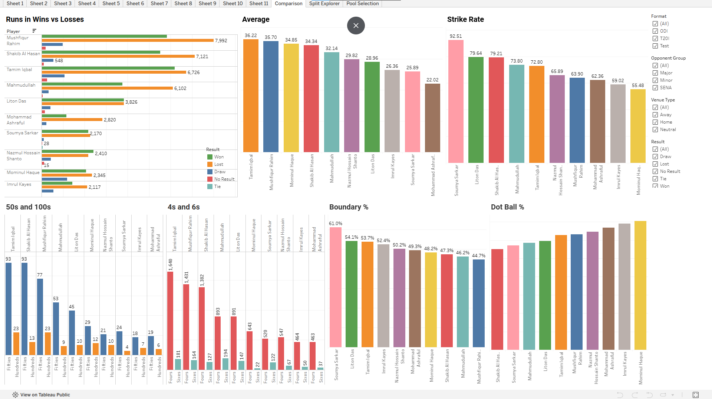

# Finding Bangladesh's Best Batsmen
 
An interactive Tableau dashboard that compares Bangladesh's top run scorers across Tests, ODIs and T20Is, built from ball-by-ball data.
 
[](https://public.tableau.com/app/profile/md.abrar.hasnat/viz/FindingBangladeshsBestBatsmen/Comparison)
 
Click the image above to open the live dashboard on Tableau Public.
 
## Questions the dashboard answers
 
- Who scored the most runs for Bangladesh, and how many came in winning and losing causes?
- Who has the best average, strike rate, boundary share and dot ball control?
- Who has the most 50s, 100s, 4s and 6s?
- How does each batter perform at home and away, and against SENA, Major and Minor teams?
- For example: who is the leading run scorer against a SENA team in that team's own country?
## Method
 
### Player pool
 
Batters are ranked by total runs across Tests, ODIs and T20Is. The top N form the comparison pool, where N is set by `POOL_SIZE` in the notebook. The notebook prints the share of all runs held by the pool and lists the top 20 so that missing names can be checked manually before widening the pool.
 
### Metrics
 
| Metric | Definition |
|---|---|
| Average | Runs divided by dismissals. Retired hurt and retired not out are not dismissals. |
| Strike Rate | Runs per 100 balls faced. Wides are not counted as balls faced. |
| 50s and 100s | Innings of 50 to 99 runs, and innings of 100 or more. |
| 4s and 6s | Boundaries hit off the bat. Four runs that were run are excluded. |
| Boundary % | Runs from 4s and 6s as a share of total runs. |
| Dot Ball % | Balls faced with no runs off the bat as a share of balls faced. |
 
### Splits
 
| Split | Values |
|---|---|
| Venue Type | **Home** (Bangladesh is the host), **Away** (the opponent is the host), **Neutral** (any other venue, including UAE grounds) |
| Opponent Group | **SENA** (South Africa, England, New Zealand, Australia), **Major** (India, Pakistan, Sri Lanka, West Indies), **Minor** (all other teams) |
| Result | Won, Lost, Draw, Tie, No Result, from Bangladesh's point of view |
 
The host of each venue is inferred from the team that has played the most matches there in the source data, so Neutral and Away labels are best treated as a close approximation.
 
## Data
 
Ball-by-ball match data comes from [Cricsheet](https://cricsheet.org) (men's Tests, ODIs and T20Is), released under the Open Data Commons Attribution License. Cricinfo was not used because it does not publish dot ball data and blocks scripted access.
 
Known limits:
 
- Cricsheet coverage is thin before about 2003, so players whose careers started around 2001 to 2002 have lower totals than their official career figures.
- Cricsheet withholds all Afghanistan matches, so Bangladesh against Afghanistan is not included.
- Super over innings are excluded.
Totals can therefore differ slightly from Cricinfo career pages.
 
## Repository contents
 
```
.
├── data
│   ├── bangladesh_batting_innings.csv
│   └── pool_selection.csv
├── data_collection.ipynb
├── Finding Bangladesh's Best Batsmen.twb
├── screenshot.png
└── README.md
```
 
| File | Description |
|---|---|
| `data/bangladesh_batting_innings.csv` | One row per pool player per innings, with runs, balls, 4s, 6s, dots, dismissal, opponent, venue, venue type, opponent group and result |
| `data/pool_selection.csv` | All Bangladesh batters ranked by total runs, with per-format runs, run share, cumulative share and a pool flag |
| `data_collection.ipynb` | Google Colab notebook that downloads the Cricsheet data and writes both CSV files |
| `Finding Bangladesh's Best Batsmen.twb` | Tableau workbook with the sheets and dashboards |
| `screenshot.png` | Dashboard preview used above |
 
## Reproduce
 
1. Open `data_collection.ipynb` in Google Colab and run all cells.
2. Optionally change `POOL_SIZE` and rerun the last two cells.
3. Download the two CSV files and place them in `data/`.
4. Open the `.twb` file in Tableau Desktop and, if prompted, point the data sources to the CSV files in `data/`.
## Tools
 
Python (pandas, requests), Google Colab, Tableau Desktop, Tableau Public.
 
